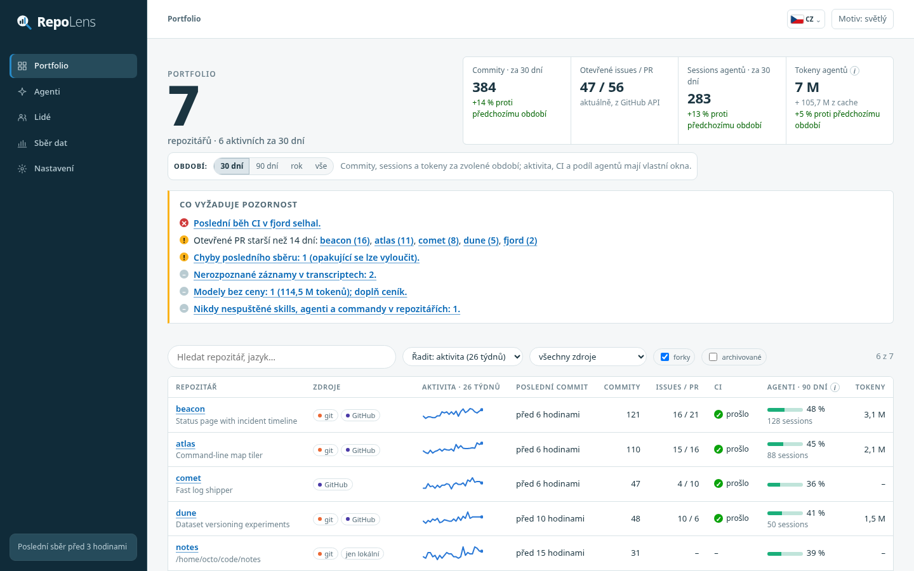
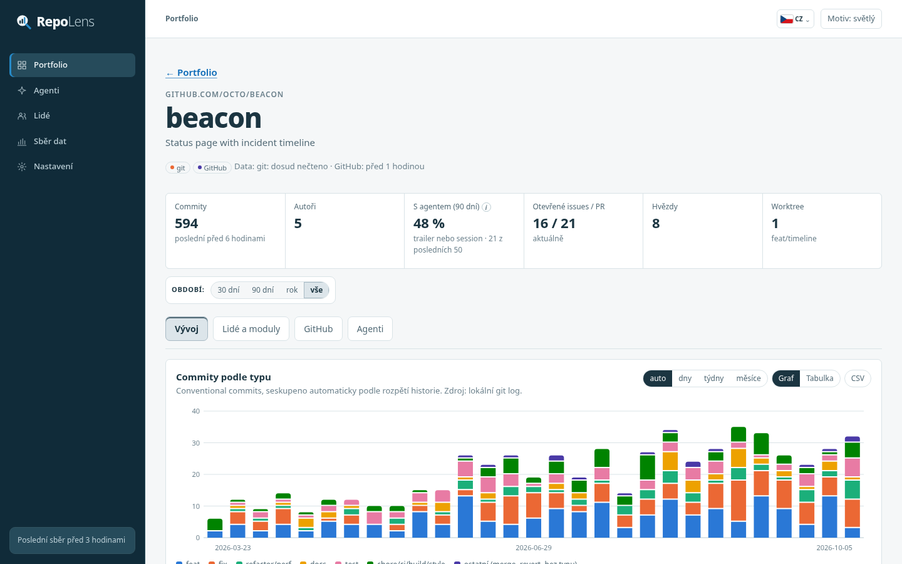
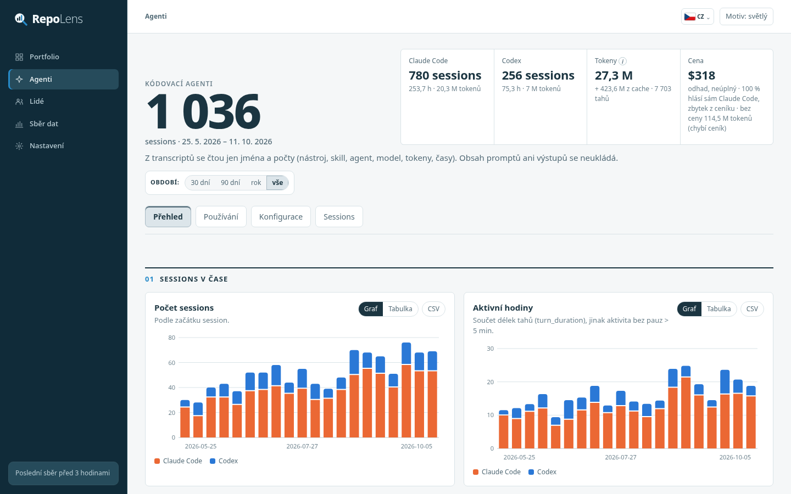
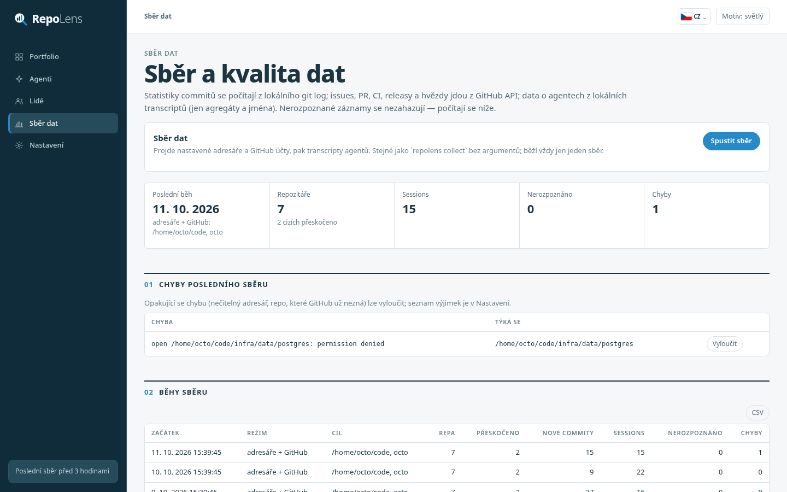
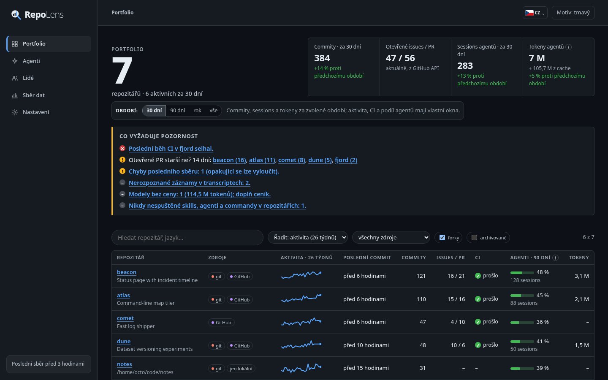
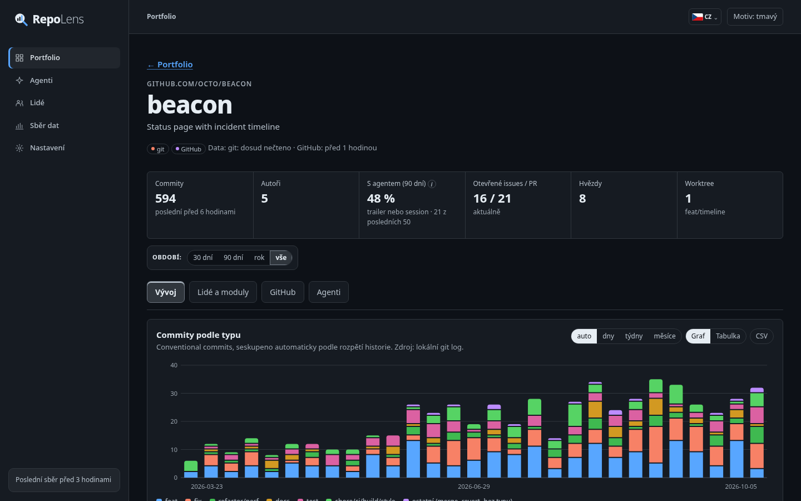
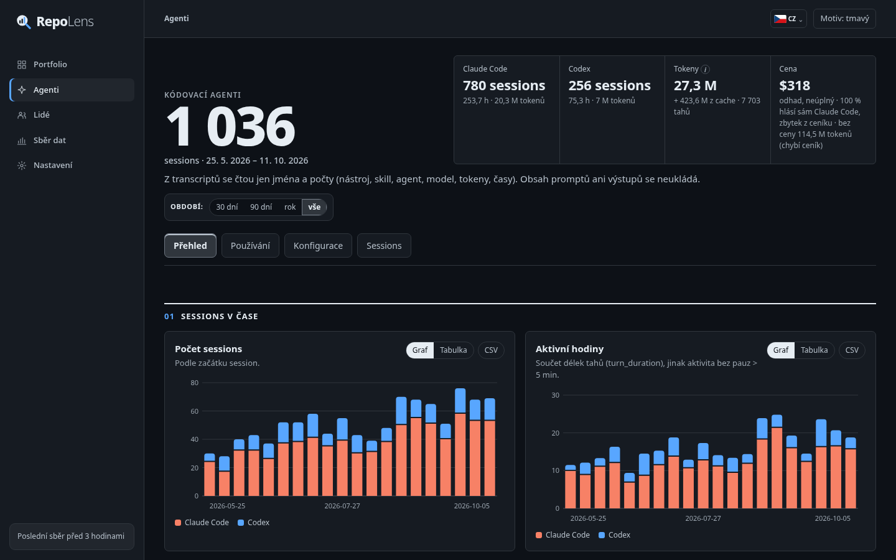
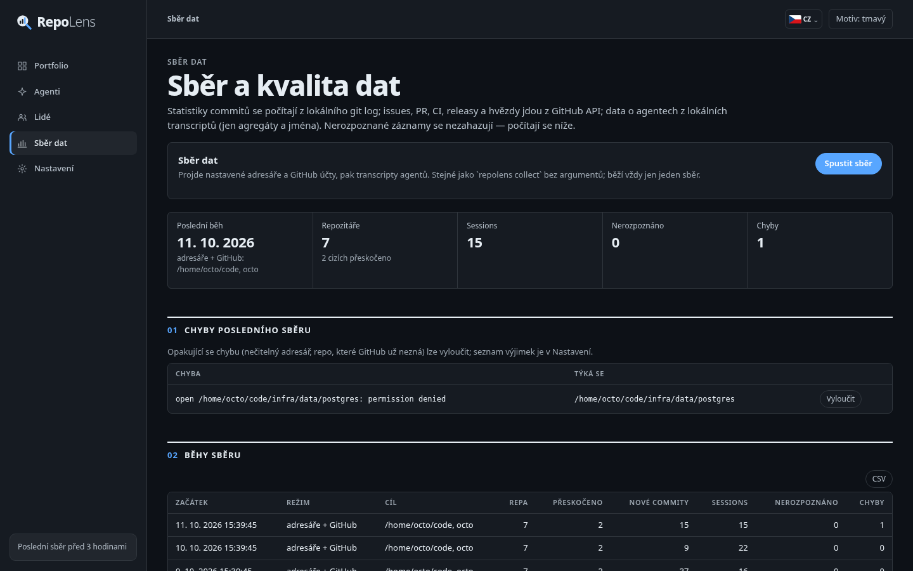

[English](README.md) · **Česky**

# repolens

Lokální přehledy vývoje pro všechny vaše repozitáře a přehled o tom, jak se v nich používají
kódovací agenti (Claude Code, Codex): sessions, modely, tokeny, cena, nástroje, subagenti, skills,
slash commandy, MCP servery, hooky a zamítnutí. Všechno běží na vašem počítači; jediný přístup
do sítě je GitHub API.

## Ukázky obrazovek

### Světlý motiv



| Detail repozitáře | Agenti | Sběr dat |
|---|---|---|
|  |  |  |

### Tmavý motiv



| Detail repozitáře | Agenti | Sběr dat |
|---|---|---|
|  |  |  |

Screenshoty ukazují vestavěná demo data (`repolens demo`): vymyšlený účet `octo` s vymyšlenými
repozitáři a lidmi.

```
repolens collect                      # kořeny a GitHub účty z konfigurace
repolens collect --dir ~/projects     # jeden adresář (režim B): lokální repa + GitHub + agenti
repolens collect --github octo        # jen GitHub (režim A)
repolens serve                        # dashboard na http://127.0.0.1:8765
repolens export --out repolens.html   # jeden statický HTML soubor, funguje offline
repolens install-timer                # pravidelný sběr (systemd uživatelský timer)
repolens demo --db demo.db            # vymyšlená data na vyzkoušení dashboardu
```

Dashboard je česky a anglicky (přepínač v horní liště, výchozí je čeština), se světlým a tmavým motivem.

## Proč vlastní nástroj

| Nástroj | Co pokrývá | Proč nestačí |
|---|---|---|
| Apache DevLake | git/GitHub metriky, DORA | těžký provoz (MySQL, Grafana, Docker), nic o agentech |
| GrimoireLab | git/GitHub, slučování identit (SortingHat) | OpenSearch a několik služeb, nic o agentech |
| gitstats, git-quick-stats | statistiky jednoho repa z gitu | jedno repo, žádný GitHub ani agenti |
| OSS Insight | hostovaná analytika | jen veřejná repa, data odcházejí ven |
| ccusage, splitrail | tokeny a cena z transcriptů Claude/Codex | žádné subagenty, skills, hooky, zamítnutí, párování s repy |

Žádný z nich nepokrývá 80 % zadání. Převzaté nápady: deduplikace usage podle `message.id`+`requestId`
(ccusage), `git log --numstat` (gitstats), slučování identit (SortingHat).

**Stack:** Go 1.26 + SQLite (`modernc.org/sqlite`, čisté Go, jediná přímá závislost). Jeden binární
soubor, sběr i server v jednom jazyce, `net/http` + `embed` ze standardní knihovny. Frontend je
vanilla JS s vlastními SVG grafy bez CDN, takže export funguje i offline.

## Instalace

```
go build -o bin/repolens ./cmd/repolens      # nebo: make build
```

Potřeba: Go ≥ 1.24 (toolchain si stáhne 1.26), `git`, pro GitHub `gh` (přihlášený) nebo `GITHUB_TOKEN`.

Na rozhlédnutí: `repolens demo --db demo.db && repolens serve --db demo.db`.

## Konfigurace

`~/.config/repolens/config.json` (jiná cesta přes `--config`). Žádné tajné údaje sem nepatří; token se bere
z `GITHUB_TOKEN` nebo `gh auth token` a nikde se neukládá. Většinu lze upravit na stránce **Nastavení**
v dashboardu: hodnoty se zvalidují, soubor se zapíše atomicky a předchozí verze zůstane jako `config.json.bak`.

```json
{
  "roots": [{"path": "~/projects", "depth": 4}, {"path": "~/work"}],
  "github_accounts": ["octo", "octo-org"],
  "include_uncloned": true,
  "owners": ["github.com/octo", "github.com/octo-org"],
  "identities": [{"name": "Octo Cat", "aliases": ["octocat", "octo@prace.example"]}],
  "prices": {"gpt-5.5": {"input": 1.25, "output": 10, "cache_read": 0.125, "cache_write": 0}},
  "prices_date": "2026-10-01",
  "fetch_prices": false,
  "ci_days": 90,
  "include_forks": false,
  "include_archived": false,
  "exclude": ["~/projects/infra/data", "github.com/octo/old-experiment"],
  "session_paths": {"~/old/app": "github.com/octo/app"}
}
```

- `roots`: adresáře, které projde `repolens collect` bez argumentů; `depth` je výchozí `scan_depth` (4).
  Kořen musí být absolutní cesta (nebo začínat `~/`); `/` a chráněné cesty (`.ssh`, `.aws`, …, i přes
  symlink) se odmítnou.
- `github_accounts`: uživatelé nebo organizace, jejichž repa se sbírají; prázdné = vlastníci z github.com
  v `owners`. S `include_uncloned` (výchozí zapnuto) se sbírají i repa bez lokálního klonu, z GitHub API.
- `owners`: „vlastní“ repozitáře. Repa bez remote se berou vždy, repa jiných vlastníků (i z jiných hostingů)
  se přeskočí a jen spočítají. Prázdné = všechno.
- `identities`: ruční slučování identit (jména, e-maily, GitHub loginy).
- `prices`: USD za milion tokenů pro modely, u kterých agent cenu nehlásí (klíč = celý název nebo prefix).
  Stránka Nastavení ukáže modely, které mají tokeny bez ceny; ceny samotné doplňujete vy.
- `prices_date`: datum, ke kterému ceník platí; ukazuje se u odhadů ceny. Ceník lze v Nastavení vložit i jako
  JSON (`{"date": "…", "prices": {…}}`).
- `fetch_prices` (volitelné, ve výchozím stavu vypnuto): ceny, které v `prices` chybí, se doplní z veřejného
  ceníku projektu LiteLLM, staženého při každém sběru přes GitHub API (`BerriAI/litellm`,
  `model_prices_and_context_window.json`); nezměněný soubor stojí jen odpověď 304. Berou se jen přesné názvy
  modelů (varianty poskytovatelů jako `azure/…` mají ceny přeprodejců). Tvoje `prices` mají vždy přednost a ceny,
  které hlásí sám agent, se nikdy nemění. Stránka Nastavení umí ceny používaných modelů i načíst do formuláře
  ke kontrole a uložení. Odhadované ceny všech uložených sessions se po každém sběru přepočítají, takže změna
  ceny platí i pro starší sessions.
- `ci_days`: jak daleko zpět se při prvním sběru stáhnou běhy GitHub Actions.
- `exclude`: adresáře, které se neprocházejí (např. svazky databází, které nejdou přečíst), a klíče repozitářů,
  na které se repolens neptá GitHubu (repo smazané na GitHubu si nechá lokální statistiky). Chybu na stránce
  *Sběr dat* lze vyloučit jedním kliknutím.
- `session_paths`: adresář sessions, který nepatří žádnému repu (přesunutý nebo smazaný klon), a repozitář, ke
  kterému se počítá. Nastavuje se jedním kliknutím v *Agenti → Sessions → Kvalita dat*; uložené sessions se
  přiřadí hned.
- Databáze: `~/.local/share/repolens/repolens.db` (`--db` nebo `"db"` v konfiguraci).

`--dir` a `--github` pro daný běh nahradí nastavené kořeny a účty. `collect` nejdřív zkontroluje
konfiguraci a při neplatné hodnotě skončí.

## Sběr

- **Z dashboardu:** *Sběr dat* → *Spustit sběr* udělá totéž co `repolens collect` a průběžně ukazuje log.
  Na stejné stránce jsou chyby posledního běhu (s tlačítkem *Vyloučit*), historie běhů, nerozpoznané záznamy
  a slovníček pojmů. V hlavičce je čas posledního dokončeného sběru.
- **Pravidelně:** `repolens install-timer [--schedule daily]` zapíše systemd uživatelskou službu a timer
  (`~/.config/systemd/user/repolens-collect.*`) a zapne ho; `--print` jednotky jen vypíše,
  `repolens uninstall-timer` je odstraní. Timer spouští `collect --strict`, takže běh s chybami nebo
  nerozpoznanými záznamy se v `systemctl --user status repolens-collect` ukáže jako selhaný. Strict posuzuje,
  na co narazil tento běh: nezměněné transcripty se znovu nečtou, zato problém, který se opakuje při každém
  běhu (nečitelný adresář, repo, které GitHub už nezná), shodí každý běh, dokud se neopraví. Když jsou nastavené
  GitHub účty a token chybí, počítá se to také jako chyba.
- Do jedné databáze běží vždy jen jeden sběr (zámek vedle souboru databáze), ať přijde z CLI, timeru
  nebo dashboardu.

## Dashboard

- **Portfolio:** panel *Co vyžaduje pozornost* (selhané CI, PR otevřené déle než 14 dní, chyby posledního
  sběru, modely bez ceny, nikdy nespuštěná konfigurace, sessions mimo repa, stará data), dlaždice s porovnáním
  proti předchozímu období a všechna repa se zdroji, aktivitou, CI, otevřenými issues/PR, podílem agentů
  a tokeny; hledání, řazení, filtr zdroje, forky a archivovaná repa zapnout/vypnout. Po najetí na název repa
  je vidět, kdy se naposledy četla jeho data z gitu a z GitHubu.
- **Repozitář:** záložky *Vývoj* (commity podle typu, kumulativně, řádky, issues vs. PR, poslední commity),
  *Lidé a moduly*, *GitHub* (otevřené issues a PR od nejstarších, staré zvýrazněné; milníky, CI, releasy,
  jazyky) a *Agenti*.
- **Agenti:** záložky *Přehled* (sessions, aktivní hodiny, tokeny a cena v čase, délka sessions, modely),
  *Použití* (nástroje, subagenti, skills, slash commandy, MCP servery, použití v čase, nakonfigurováno vs.
  použito, hooky a zamítnutí), *Konfigurace* (inventář, kdy vznikala, atribuce commitů) a *Sessions* (všechny
  sessions s filtrem podle repa, agenta a modelu, po stránkách, každá s detailem; porovnání projektů; sessions
  mimo repa s tlačítkem *Přiřadit*).
- **Lidé:** sloučené identity napříč repozitáři, každý člověk s vlastní stránkou: aktivita po repech a měsících,
  typy commitů, poslední commity, identity.
- **Sběr dat** a **Nastavení** viz výše.

Výběr období (30 dní, 90 dní, rok, vše) na stránkách portfolia, repa, lidí, osoby a agentů se drží v URL; se
zvoleným obdobím ukazují dlaždice změnu proti předchozímu stejně dlouhému období. Každá stránka říká, na co se
období vztahuje (otevřené položky jsou například vždy aktuální).

**Tokeny** jsou vstup + výstup. Čtení a zápis cache se ukazují vedle, ne v součtu: opakují stejný kontext
a jinak by přehlušily každý součet.

Každý graf má tabulkové zobrazení, stažení CSV a ovládání klávesnicí, stejně jako větší tabulky. U každého
údaje je vidět, odkud pochází (lokální git, GitHub API, transcripty), odhady jsou tak označené a pojmy jako
podíl agentů mají vysvětlivku (ⓘ). Na úzké obrazovce se navigace sbalí do menu.

## Export

`repolens export --out repolens.html [--lang cs|en] [--anonymize]` zapíše jeden soběstačný soubor se všemi
daty a skripty uvnitř a s CSP, která zakazuje jakýkoli přístup do sítě. `--lang` určí jazyk, ve kterém se
otevře (čtenář může přepnout). `--anonymize` nahradí jména repozitářů, vlastníků a lidí, e-maily, cesty,
větve, předměty commitů, milníky, releasy, štítky a názvy workflow pseudonymy, stejně jako jména vašich
vlastních skills, agentů, commandů, MCP serverů a pluginů (konzistentně, takže použití dál sedí ke konfiguraci).
Z pravidel oprávnění zůstane jen jméno nástroje a texty chyb se skryjí. Čísla, data, jména vestavěných nástrojů
a události hooků zůstanou; autoři, které databáze vede jako boty, si jména nechají.

## Režimy

### B — lokální adresář (`collect --dir`, nebo `roots`)

1. Najde git repozitáře do hloubky kořene a worktree přiřadí k hlavnímu repu, i když leží jinde
   (např. `~/.herdr/worktrees`). Přeskakuje `node_modules`, `vendor`, `target`, … a cesty z denylistu.
   Překrývající se kořeny se projdou jednou; druhý klon stejného remote se započítá pod první.
2. Statistiky commitů z `git log --numstat`: typ (conventional commits), řádky, adresáře, trailery.
   Analyzovaná historie je `origin/HEAD` (nebo `origin/main|master|develop|trunk`), lokální výchozí větev
   a odpojený `HEAD` (submoduly). Checkoutnutá feature větev se nepočítá, takže přepnutí větve čísla nezmění.
   Čtení je inkrementální (nové tipy `--not` staré); po přepsání historie, nebo když se mělký klon doplní,
   se repo načte znovu.
3. GitHub data pro repa s remote na github.com a pro repa nastavených účtů: metadata, issues, PR, milníky,
   štítky, releasy, jazyky a běhy Actions (když je k dispozici token).
4. Agenti: transcripty Claude Code a Codex, konfigurace agentů v repech i globálně, atribuce commitů.
5. Sloučí identity autorů.

### A — jen GitHub (`collect --github <účet>`)

Vypíše repozitáře účtu (bez forků a archivovaných, pokud je konfigurace nepovolí) a stáhne metadata, issues,
PR a CI. Commity jdou z GraphQL historie výchozí větve (řádky po commitech, bez rozpadu po adresářích).
Když je repo naklonované i lokálně, vyhrávají lokální data.

Oba režimy zapisují do stejné databáze. UI ukazuje, odkud data kterého repa jsou
(`git`, `GitHub`, `bez API`, `jen lokální`).

**GitHub API:** GraphQL s aliasy, takže metadata plus první stránka issues a PR pro 8 repozitářů stojí jeden
dotaz; repo, které GitHub odmítne, se nahlásí a ostatní pokračují. Respektuje limity (`X-RateLimit-*`,
`Retry-After`, sekundární limity) čekáním místo selhání. Opakuje odpovědi 5xx a HTML chybové stránky, které
GitHub občas vrací místo JSON. Stabilní první stránky REST odpovědí se cachují s ETag a hlavičkou `Link` (304).
Stahují se jen změny od posledního běhu; běhy CI se znovu čtou 3 dny zpět, aby běhy, které ještě běžely, dostaly
konečný stav, a historie 14 dní zpět, protože ji GitHub filtruje podle data commitu. Přesměrování se následují
jen přes HTTPS na host API.

## Co se odkud čte

| Zdroj | Co se čte | Co se ukládá |
|---|---|---|
| `git log` v každém repu | hash, autor, čas, předmět, trailery, `--numstat` | totéž + typ commitu a agent z trailerů |
| GitHub API | repo, issues, PR, milníky, štítky, releasy, jazyky, Actions | názvy, stavy, časy, loginy autorů |
| `~/.claude/projects/*/*.jsonl` + `…/<session>/subagents/*` | záznamy sessions | jen agregáty, viz níže |
| `~/.codex/sessions/**/rollout-*.jsonl` | záznamy sessions | jen agregáty |
| `CLAUDE.md`, `AGENTS.md`, `GEMINI.md`, `.claude/**`, `.mcp.json`, `.codex/**`, `.github/copilot-instructions.md`, `.cursor/rules`, `.cursorrules` v repech | existence, `name:` z front-matter, oprávnění, hooky (událost + matcher), jména MCP serverů | jména, cesty, git historie souboru (vznik, počet změn) |
| `~/.claude/{skills,agents,commands,rules,settings.json}`, `~/.claude/plugins/installed_plugins.json` + složky pluginů | totéž, globálně a po pluginech | totéž, rozsah `global` / `plugin` |
| `~/.codex/{AGENTS.md,skills,rules,config.toml,hooks.json}` | jména skills a pravidel, `[mcp_servers.X]` | jména |
| `~/.cursor`, `~/.gemini/tmp`, `~/.config/github-copilot` | jen počet souborů | počet („nalezeno, neparsováno“) |

### Co se z transcriptů ukládá

Za session: nástroj, cwd, začátek a konec, aktivní čas, počet tahů, okna aktivity. Spotřeba tokenů po modelech
(vstup, výstup, čtení/zápis cache, reasoning) a cena, kterou agent sám hlásí (`cost-state` v Claude Code).
Pojmenované čítače: volání nástrojů (a jejich chyby), typy subagentů (počet a délka), skills, slash commandy
(jen jméno uvnitř `<command-name>`), MCP servery, zamítnutí (`toolDenialKind`, přerušení), hooky podle události
a zásahy hooků, chyby API. Nakonec počty nerozpoznaných záznamů a chyb.

Každé uložené jméno musí vypadat jako identifikátor (písmena, číslice, `_:./@+-[]()|·*`, nejvýš 100 znaků).
Cokoli jiného, např. text, který model napsal do pole `skill`, se uloží jako `(neplatné jméno)`.

### Co se nikdy neukládá ani neukazuje

- prompty, odpovědi, bloky přemýšlení, vstupy a výstupy nástrojů, Bash příkazy, diffy;
- příkazy hooků (jen událost a matcher), env a argumenty MCP serverů;
- hodnoty v pravidlech oprávnění: Bash pravidlo si nechá jen jména proměnných, příkaz, známé podpříkazy
  a přepínače bez hodnoty, např. `Bash(PGPASSWORD=x psql -h db:*)` → `Bash(PGPASSWORD=*** psql …:*)`; ostatní
  pravidla přijdou o přihlašovací údaje v URL, query stringy a tokeny (`ghp_…`, `sk-…`, `AKIA…`, …);
- GitHub token (nikdy v logu, cache, chybových hláškách, prohlížeči ani výstupu).

### Co se nikdy nečte

`.env*`, `id_rsa*`/`id_ed25519*`/…, `*.pem`, `*.key`, `*.p12`, `credentials*`, `.credentials.json`, `auth.json`,
`.netrc`, `.git-credentials`, `.npmrc`, `.pypirc`, `.pgpass`, `~/.claude.json` a cokoli uvnitř `.ssh`, `.aws`,
`.gnupg`, `.kube`, `.docker`, kdekoli ve skenovaném stromu (bez ohledu na velikost písmen). Každé čtení souboru
jde přes `internal/privacy`, který navíc rozbaluje symlinky (odkaz `.claude/settings.json → ~/.ssh/id_rsa` se
odmítne) a otevírá jen běžné soubory. Řádky transcriptů delší než 64 MiB se přeskočí a započítají.

Pozor: databáze a běžný export obsahují e-maily autorů commitů, názvy issues a cesty k repům.
Na cokoli, co sdílíte, použijte `export --anonymize`.

### Server dashboardu

`repolens serve` poslouchá jen na 127.0.0.1 a odmítá cizí hlavičku `Host` (DNS rebinding). Každá odpověď nese
přísnou CSP. Požadavky, které něco mění (uložení nastavení, spuštění sběru), navíc potřebují stejný původ
a CSRF token platný pro daný proces, který má jen stránka vydaná serverem (týká se `PUT /api/settings`,
`POST /api/collect`, `POST /api/exclude` a `POST /api/assign`); těla mají omezenou velikost, jen JSON,
a neznámé klíče se odmítnou. Požadavky z cizích stránek na `/api/` se odmítají úplně. Hranicí je počítač:
na stroji sdíleném s dalšími uživateli může dashboard otevřít každý, kdo se dostane na 127.0.0.1.

## Jak se commity přiřazují agentům

Dva signály, v UI vždy odděleně:
1. **Trailer:** `Co-Authored-By`, `Agent:`, `Generated-By` apod. se jménem Claude, Copilot, Codex, Cursor,
   Gemini…, nebo autor `…[bot]`.
2. **Okno session:** commit vznikl uvnitř okna aktivity session agenta ve stejném repu nebo jeho worktree
   (+10 min). Okna jsou úseky záznamů s mezerami pod 5 minut, ne celý rozsah session; obnovená session může
   trvat dny.

Druhý signál je důležitý, když agent trailery nepřidává (`includeCoAuthoredBy: false`).

## Párování sessions s repozitáři

Podle `cwd` session (nejdelší prefix cesty repa, worktree nebo dalšího klonu). Záložně podle zakódované cesty
projektu, kterou Claude Code používá v názvu složky s transcripty a ve scratchpadech
(`/tmp/claude-…/-home-…-project/…`). Sessions mimo vaše repa se ukládají také a jsou v sekci „Kvalita dat“;
páruje se znovu při každém běhu, takže repo nalezené později si vezme i své starší sessions.

Claude Code staré transcripty maže (`cleanupPeriodDays`). Sessions, jejichž soubor zmizel, v databázi
zůstávají, takže historie s každým `collect` roste.

## Nerozpoznané záznamy

Formáty transcriptů nejsou zdokumentované. Parsery znají typy a podtypy záznamů, které se skutečně vyskytly
(Claude Code 2.1.x, Codex CLI červen–říjen 2026). Cokoli jiného se počítá jako nerozpoznané
(např. `attachment:new_type`) a ukazuje na stránce *Sběr dat*. Poškozený řádek se počítá jako chyba a běh
pokračuje. Když se parser změní (`transcript.ParserVersion`), transcripty se zpracují znovu.

Spotřeba tokenů je maximum za odpověď API: streamované odpovědi (hlavně v transcriptech subagentů) nesou
nejdřív částečný počet výstupních tokenů, pak konečný. Tokeny a cena session zahrnují vlákna, která spustila
(subagenti Codexu).

## Vývoj

```
make test     # go test -race ./...
make cover    # pokrytí
make vet      # go vet + gofmt
make dev      # build + restart serveru v Herdr panelu "server"
```

Projekt se vyvíjí v Herdru s panelem `tests` (testy, sběr) a panelem `server` (`repolens serve`).
`make dev` najde panel podle jména a restartuje server.

Testy parserů běží na fixtures ze **skutečných** souborů z vývojového stroje, anonymizovaných:
`internal/gitlog/testdata` (git log), `internal/github/testdata` (odpovědi GraphQL/REST),
`internal/transcript/testdata/{claude,codex}` (JSONL včetně subagentů). Očekávané hodnoty se spočítaly
nezávisle Python skriptem, ne zpětně z Go parseru. Okrajové případy (poškozené řádky, neznámé typy,
duplicitní zprávy) mají vlastní ručně sestavené fixtures. End-to-end test projde git → transcripty → reporty.
Test hlídá, že každý text UI má anglický překlad se stejnými zástupnými symboly.

Každý test byl falzifikován: mutační skript rozbije vždy jeden kus logiky a ověří, že testy selžou
(159 mutací napříč všemi balíčky, ve dvou kolech).

## Co záměrně dodáno není

- **Cursor, Gemini CLI, Copilot:** soubory se jen počítají, jejich formáty se neparsují.
- **Codex:** skills, slash commandy a hooky se v rolloutech neobjevují, takže v přehledu nejsou.
  Chyby nástrojů pokrývají jen `exec_command` (`CommandExecution failed`) a `apply_patch`.
- **Ceny:** žádné ceníky se nevymýšlejí. Cena Claude Code je to, co hlásí agent sám; ostatní modely se oceňují
  podle vašeho ceníku, nebo (když je to zapnuté) podle ceníku LiteLLM přes GitHub API; nic jiného se z internetu
  nestahuje. Vše je označené jako odhad a tokeny bez ceny se ukazují.
- **Režim A:** bez rozpadu po adresářích (GraphQL ho nedává), jen součty řádků po commitech. Místo GitHub
  *stats API* se používají počty řádků po commitech z GraphQL historie (přesnější a inkrementální).
- **GitHub Actions:** jen posledních `ci_days` dní (velká repa mají tisíce běhů).
- **Nemergnuté feature větve a větve worktree** se nepočítají (viz „Režimy“, bod 2).
- **Rozdělení identit:** ruční mapa umí identity jen slučovat, ne rozdělovat.
- **Bitbucket a další hostingy:** berou se jako lokální repa (bez issues, PR a CI).
- **Výběr období** omezuje commity, sessions a to, co se z nich počítá; otevřené issues a PR, releasy,
  porovnání projektů, atribuce commitů a konfigurace jsou vždy aktuální nebo za celou dobu. Statický export
  obsahuje jen pohled za celou dobu (bez výběru období a porovnání).
- **Pravidelný sběr** je připravený pro systemd; na jiných systémech použijte cron nebo launchd
  s `repolens collect --strict`.
