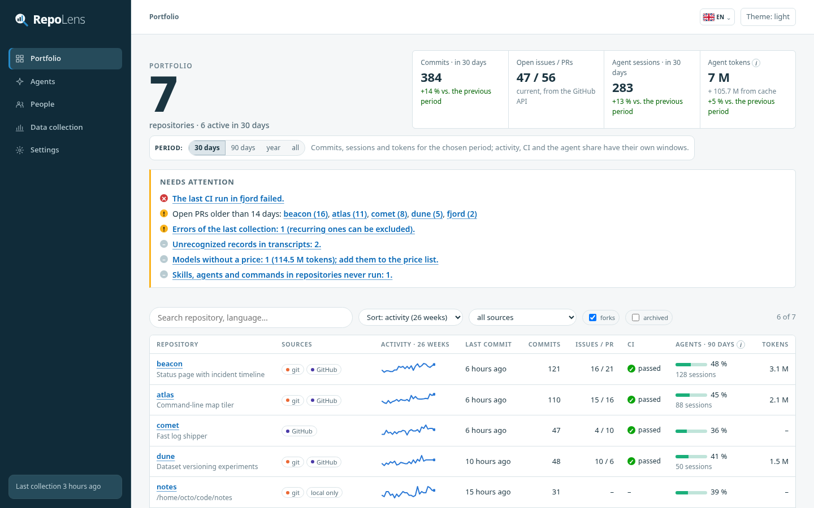
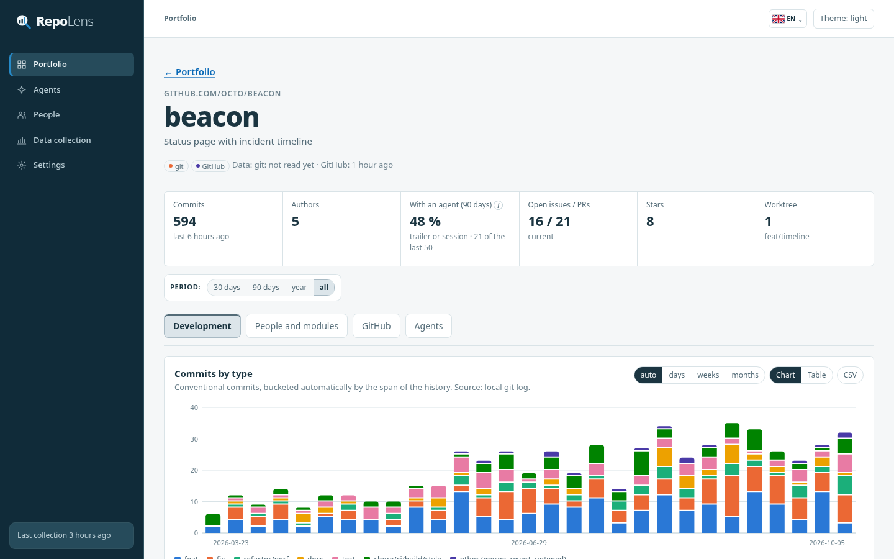
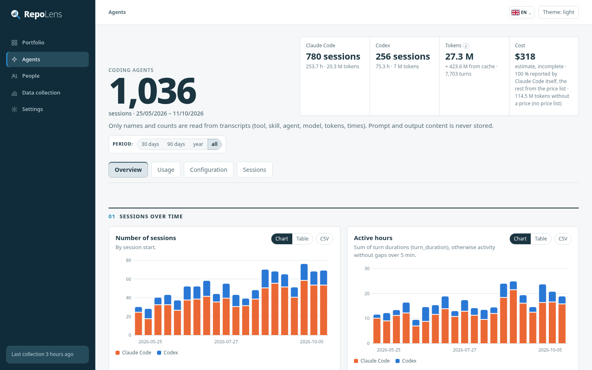
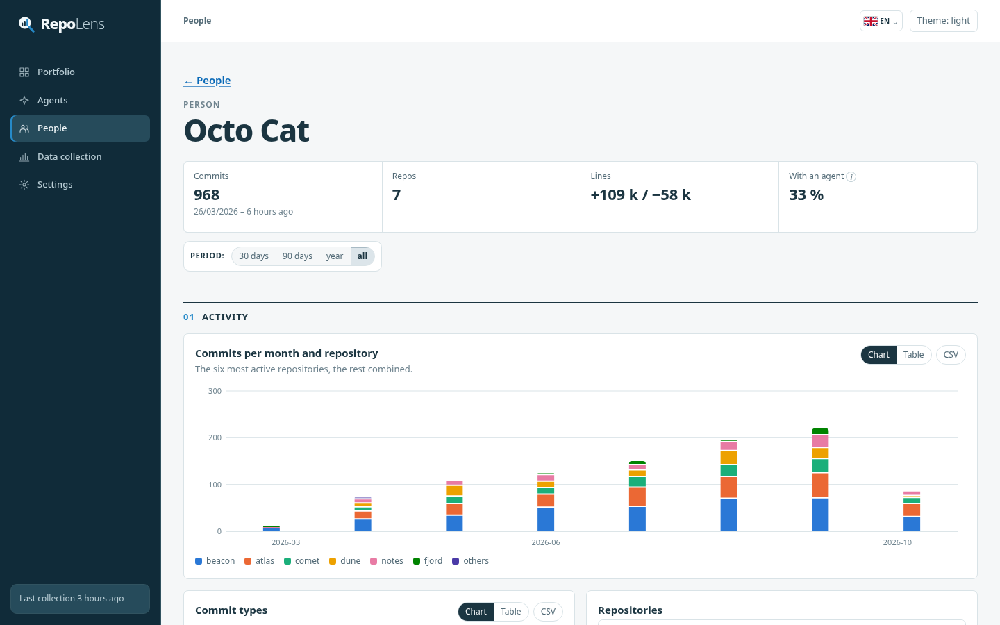
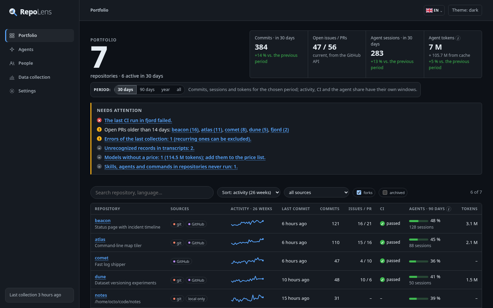
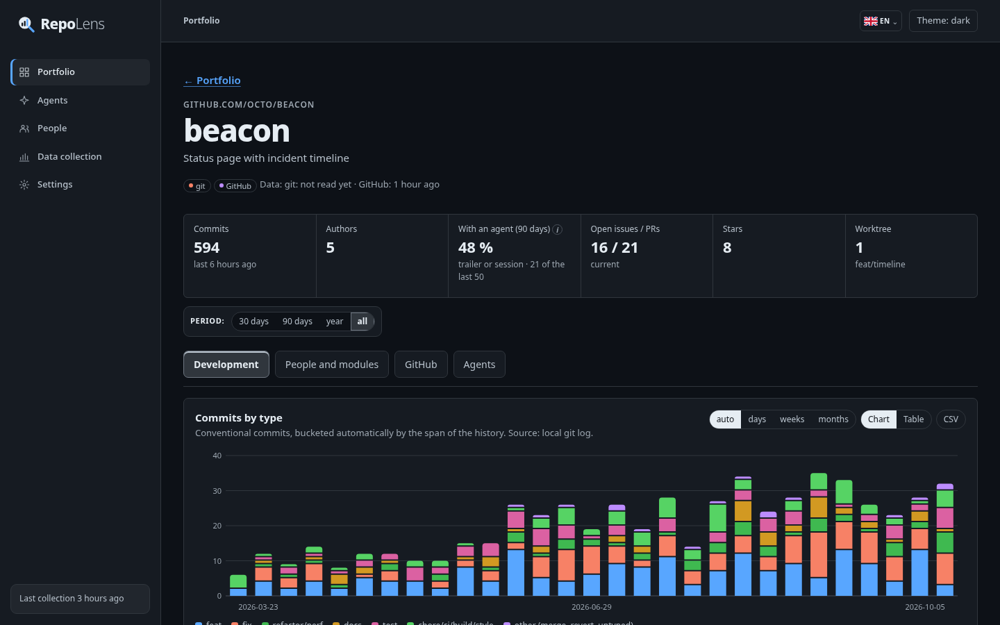
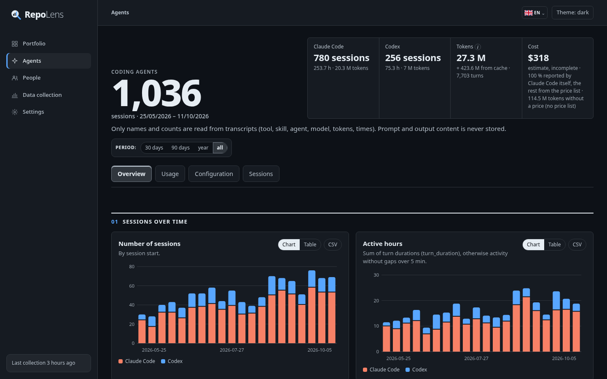
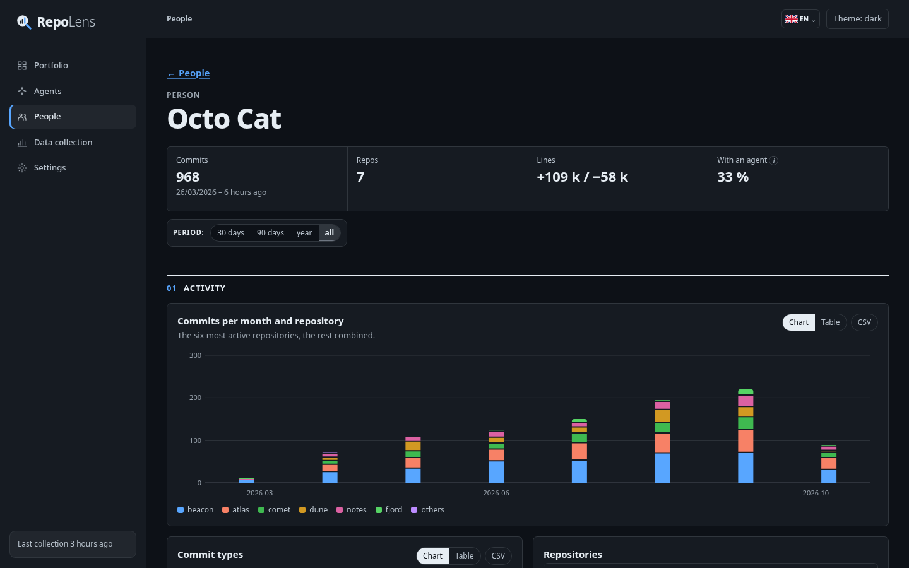

**English** · [Česky](README.cs.md)

# repolens

Local development overviews for all your repositories, plus a view of how coding agents
(Claude Code, Codex) are used in them: sessions, models, tokens, cost, tools, subagents, skills,
slash commands, MCP servers, hooks and denials. Everything runs on your machine; the only network
access is the GitHub API.

## Screenshots

### Light theme



| Repository detail | Agents | Person |
|---|---|---|
|  |  |  |

### Dark theme



| Repository detail | Agents | Person |
|---|---|---|
|  |  |  |

The screenshots show the built-in demo data (`repolens demo`): an invented account `octo` with
invented repositories and people.

```
repolens collect                      # roots and GitHub accounts from the configuration
repolens collect --dir ~/projects     # one directory (mode B): local repositories + GitHub + agents
repolens collect --github octo        # GitHub only (mode A)
repolens serve                        # dashboard at http://127.0.0.1:8765
repolens export --out repolens.html   # one static HTML file that works offline
repolens install-timer                # collect regularly (systemd user timer)
repolens demo --db demo.db            # invented data to try the dashboard
```

The dashboard is in Czech and English (switch in the top bar; Czech is the default), with a light
and a dark theme.

## Why a new tool

| Tool | What it covers | Why it is not enough |
|---|---|---|
| Apache DevLake | git/GitHub metrics, DORA | heavy to run (MySQL, Grafana, Docker), nothing about agents |
| GrimoireLab | git/GitHub, identity merging (SortingHat) | OpenSearch plus several services, nothing about agents |
| gitstats, git-quick-stats | statistics for one repository from git | one repository, no GitHub, no agents |
| OSS Insight | hosted analytics | public repositories only, data leaves the machine |
| ccusage, splitrail | tokens and cost from Claude/Codex transcripts | no subagents, skills, hooks or denials; no mapping to repositories |

None of them covers 80 % of the brief. Ideas taken from them: usage deduplication by
`message.id`+`requestId` (ccusage), `git log --numstat` (gitstats), identity merging (SortingHat).

**Stack:** Go 1.26 + SQLite (`modernc.org/sqlite`, pure Go, the only direct dependency). One binary,
collector and server in one language, `net/http` + `embed` from the standard library. The frontend is
vanilla JS with hand-written SVG charts and no CDN, so the export works offline.

## Installation

```
go build -o bin/repolens ./cmd/repolens      # or: make build
```

Requires Go ≥ 1.24 (the toolchain fetches 1.26), `git`, and for GitHub either a logged-in `gh` or `GITHUB_TOKEN`.

To look around first: `repolens demo --db demo.db && repolens serve --db demo.db`.

## Configuration

`~/.config/repolens/config.json` (another path via `--config`). It holds no secrets: the token comes from
`GITHUB_TOKEN` or `gh auth token` and is never stored. Most of it can be edited on the dashboard's
**Settings** page, which validates the values, writes the file atomically and keeps the previous version
as `config.json.bak`.

```json
{
  "roots": [{"path": "~/projects", "depth": 4}, {"path": "~/work"}],
  "github_accounts": ["octo", "octo-org"],
  "include_uncloned": true,
  "owners": ["github.com/octo", "github.com/octo-org"],
  "identities": [{"name": "Octo Cat", "aliases": ["octocat", "octo@work.example"]}],
  "prices": {"gpt-5.5": {"input": 1.25, "output": 10, "cache_read": 0.125, "cache_write": 0}},
  "prices_date": "2026-10-01",
  "fetch_prices": false,
  "ci_days": 90,
  "include_forks": false,
  "include_archived": false,
  "exclude": ["~/projects/infra/data", "github.com/octo/old-experiment"],
  "session_paths": {"~/old/app": "github.com/octo/app"}
}
```

- `roots`: directories scanned by `repolens collect` without arguments; `depth` defaults to `scan_depth` (4).
  A root must be an absolute path (or start with `~/`); `/` and protected paths (`.ssh`, `.aws`, …, also
  through a symlink) are refused.
- `github_accounts`: users or organisations whose repositories are collected; empty = the github.com
  `owners`. With `include_uncloned` (default on), repositories without a local clone are collected too,
  from the GitHub API.
- `owners`: which repositories count as yours. Repositories without a remote always count; repositories of other
  owners (including other hosts) are skipped and only counted. Empty = everything.
- `identities`: manual identity merging (names, e-mails, GitHub logins).
- `prices`: USD per million tokens for models whose agent does not report cost (key = full name or prefix).
  The Settings page lists models that have tokens without a price; the prices themselves are yours to enter.
- `prices_date`: the date the price list is valid for; shown next to cost estimates. A price list can also be
  pasted as JSON on the Settings page (`{"date": "…", "prices": {…}}`).
- `fetch_prices` (optional, off by default): fill in prices missing from `prices` with the public price list of
  the LiteLLM project, downloaded through the GitHub API (`BerriAI/litellm`, `model_prices_and_context_window.json`)
  on every collection; an unchanged file costs a 304. Only exact model names are used (provider variants such
  as `azure/…` carry resellers' prices). Your `prices` always win and costs the agent reports itself are never
  changed. The Settings page can also load the prices of the models you use into the form, for you to check
  and save. Estimated costs of all stored sessions are recomputed after every collection, so a changed price
  applies to past sessions too.
- `ci_days`: how far back GitHub Actions runs are fetched on the first collection.
- `exclude`: directories that are not scanned (for example database volumes that cannot be read) and repository
  keys repolens does not ask GitHub about (a repository deleted on GitHub keeps its local statistics). An error
  on the *Data collection* page can be excluded with one click.
- `session_paths`: a session directory that belongs to no repository (a moved or deleted clone) and the repository
  it counts for. Set from *Agents → Sessions → Data quality* with one click; applied to stored sessions at once.
- Database: `~/.local/share/repolens/repolens.db` (`--db` or `"db"` in the config).

`--dir` and `--github` replace the configured roots and accounts for that run. `collect` validates the
configuration first and stops on any invalid value.

## Collecting

- **From the dashboard:** *Data collection* → *Start collection* runs the same as `repolens collect` and
  streams its log. The same page lists the errors of the last run (with *Exclude*), the run history,
  unrecognized records and a glossary of the terms the dashboard uses. The header shows when the last
  collection finished.
- **Regularly:** `repolens install-timer [--schedule daily]` writes a systemd user service and timer
  (`~/.config/systemd/user/repolens-collect.*`) and enables it; `--print` only prints the units,
  `repolens uninstall-timer` removes them. The timer runs `collect --strict`, so a run with errors or
  unrecognized records shows up as failed in `systemctl --user status repolens-collect`. Strict mode judges
  what this run met: unchanged transcripts are not re-read, while a problem that recurs on every run (an
  unreadable directory, a repository GitHub no longer knows) fails every run until it is fixed. When GitHub
  accounts are configured but no token is available, that also counts as an error.
- Only one collection runs at a time per database (a lock next to the database file), whether it comes
  from the CLI, the timer or the dashboard.

## Dashboard

- **Portfolio:** a *Needs attention* panel (failing CI, pull requests open for more than 14 days, errors of
  the last collection, models without a price, configuration never used, sessions outside repositories, stale
  data), tiles compared with the previous period, and all repositories with sources, activity, CI, open
  issues/PRs, agent share and tokens; search, sorting, source filter, forks and archived on/off. Hovering a
  repository name shows when its git and GitHub data were last read.
- **Repository:** tabs *Development* (commits by type, cumulative, lines, issues vs. PRs, recent commits),
  *People and modules*, *GitHub* (open issues and PRs oldest first, old ones highlighted; milestones, CI,
  releases, languages) and *Agents*.
- **Agents:** tabs *Overview* (sessions, active hours, tokens and cost over time, session length, models),
  *Usage* (tools, subagents, skills, slash commands, MCP servers, use over time, configured vs. used, hooks and
  denials), *Configuration* (inventory, when it was created, commit attribution) and *Sessions* (all sessions
  filterable by repository, agent and model, paged, each with a detail page; project comparison; sessions
  outside repositories with *Assign*).
- **People:** merged identities across repositories, each with a page: activity per repository and month,
  commit types, recent commits, identities.
- **Data collection** and **Settings** as described above.

A period switch (30 days, 90 days, a year, everything) on the portfolio, repository, people, person and agents
pages is kept in the URL; with a period chosen the tiles show the change against the period before. Each page
says what the period applies to (open items, for example, are always current).

**Tokens** are input + output. Cache reads and writes are shown next to them, not added: they repeat the same
context and would otherwise dominate every total.

Every chart has a table view, a CSV download and keyboard navigation, and so do the larger tables. Each figure
says where it comes from (local git, GitHub API, transcripts), estimates are labelled as such, and terms such
as the agent share carry an explanation (ⓘ). On narrow screens the navigation folds into a menu.

## Export

`repolens export --out repolens.html [--lang cs|en] [--anonymize]` writes one self-contained file with all
data and scripts inlined and a CSP that forbids any network access. `--lang` picks the language it opens in
(the viewer can switch). `--anonymize` replaces repository, owner and people names, e-mails, paths,
branches, commit subjects, milestones, releases, labels and workflow names with pseudonyms, and so are the
names of your own skills, agents, commands, MCP servers and plugins (consistently, so usage still matches the
configuration). Permission rules keep only the tool name and error texts are hidden. Numbers, dates, built-in
tool names and hook events stay; authors the database marks as bots keep their names.

## Modes

### B — local directory (`collect --dir`, or `roots`)

1. Finds git repositories up to the root's depth and groups worktrees under their main repository,
   even when they live elsewhere (e.g. `~/.herdr/worktrees`). Skips `node_modules`, `vendor`, `target`, …
   and denylisted paths. Overlapping roots are scanned once; a second clone of the same remote is counted
   under the first one.
2. Commit statistics from `git log --numstat`: type (conventional commits), lines, directories, trailers.
   The analysed history is `origin/HEAD` (or `origin/main|master|develop|trunk`), the local default branch,
   and a detached `HEAD` (submodules). A checked-out feature branch is not included, so switching branches
   does not change the numbers. Reading is incremental (new tips `--not` old tips); after a history rewrite,
   or when a shallow clone becomes complete, the repository is reloaded.
3. GitHub data for repositories with a github.com remote, and for repositories of the configured accounts:
   metadata, issues, PRs, milestones, labels, releases, languages and Actions runs (when a token is available).
4. Agents: Claude Code and Codex transcripts, agent configuration in repositories and globally, commit attribution.
5. Merges author identities.

### A — GitHub only (`collect --github <account>`)

Lists the account's repositories (without forks and archived ones unless the config allows them), then fetches
metadata, issues, PRs and CI. Commits come from the default branch's GraphQL history (line counts per commit,
no per-directory breakdown). When a repository is also cloned locally, local data wins.

Both modes write to the same database. The UI shows where each repository's data comes from
(`git`, `GitHub`, `no API`, `local only`).

**GitHub API:** GraphQL with aliases, so metadata plus the first page of issues and PRs for 8 repositories
cost one query; a repository GitHub refuses is reported and the others continue. Respects rate limits
(`X-RateLimit-*`, `Retry-After`, secondary limits) by waiting rather than failing. Retries 5xx responses and
the HTML error pages GitHub sometimes returns instead of JSON. Stable first pages of REST responses are cached
with their ETag and `Link` header (304). Only changes since the last run are fetched; CI runs are re-read for
3 days back so runs that were still in progress get their final state, and history 14 days back because GitHub
filters it by commit date. Redirects are followed only over HTTPS on the API host.

## What is read from where

| Source | What is read | What is stored |
|---|---|---|
| `git log` in each repository | hash, author, time, subject, trailers, `--numstat` | the same + commit type and agent from trailers |
| GitHub API | repository, issues, PRs, milestones, labels, releases, languages, Actions | names, states, times, author logins |
| `~/.claude/projects/*/*.jsonl` + `…/<session>/subagents/*` | session records | aggregates only, see below |
| `~/.codex/sessions/**/rollout-*.jsonl` | session records | aggregates only |
| `CLAUDE.md`, `AGENTS.md`, `GEMINI.md`, `.claude/**`, `.mcp.json`, `.codex/**`, `.github/copilot-instructions.md`, `.cursor/rules`, `.cursorrules` in repositories | existence, front-matter `name:`, permissions, hooks (event + matcher), MCP server names | names, paths, git history of the file (created, number of changes) |
| `~/.claude/{skills,agents,commands,rules,settings.json}`, `~/.claude/plugins/installed_plugins.json` + plugin folders | the same, globally and per plugin | the same, scope `global` / `plugin` |
| `~/.codex/{AGENTS.md,skills,rules,config.toml,hooks.json}` | skill and rule names, `[mcp_servers.X]` | names |
| `~/.cursor`, `~/.gemini/tmp`, `~/.config/github-copilot` | file count only | count ("found, not parsed") |

### Stored from transcripts

Per session: tool, cwd, start and end, active time, number of turns, activity windows. Token usage per model
(input, output, cache read/write, reasoning) and the cost the agent itself reports (`cost-state` in Claude Code).
Named counters: tool calls (and their errors), subagent types (count and duration), skills, slash commands
(only the name inside `<command-name>`), MCP servers, denials (`toolDenialKind`, interruptions), hooks by event
and hook interventions, API errors. Finally, counts of unrecognized records and errors.

Every stored name must look like an identifier (letters, digits, `_:./@+-[]()|·*`, at most 100 characters).
Anything else, e.g. text a model wrote into the `skill` field, is stored as `(invalid name)`.

### Never stored or shown

- prompts, responses, thinking blocks, tool inputs and outputs, Bash commands, diffs;
- hook commands (only event and matcher), MCP server env and arguments;
- values in permission rules: a Bash rule keeps variable names, the command, known subcommands and value-less
  switches only, e.g. `Bash(PGPASSWORD=x psql -h db:*)` → `Bash(PGPASSWORD=*** psql …:*)`; other rules lose
  URL credentials, query strings and token literals (`ghp_…`, `sk-…`, `AKIA…`, …);
- the GitHub token (never in logs, the cache, error messages, the browser or output).

### Never read

`.env*`, `id_rsa*`/`id_ed25519*`/…, `*.pem`, `*.key`, `*.p12`, `credentials*`, `.credentials.json`, `auth.json`,
`.netrc`, `.git-credentials`, `.npmrc`, `.pypirc`, `.pgpass`, `~/.claude.json` and anything inside `.ssh`, `.aws`,
`.gnupg`, `.kube`, `.docker`, anywhere in the scanned tree (case-insensitive). Every file read goes through
`internal/privacy`, which also resolves symlinks (a link such as `.claude/settings.json → ~/.ssh/id_rsa` is
refused) and only opens regular files. Transcript lines longer than 64 MiB are skipped and counted.

Note: the database and a plain export contain commit author e-mails, issue titles and repository paths.
Use `export --anonymize` for anything you share.

### The dashboard server

`repolens serve` listens on 127.0.0.1 only and rejects foreign `Host` headers (DNS rebinding). Every response
carries a strict CSP. Requests that change something (saving settings, starting a collection) also need the
same origin and a per-process CSRF token that only the served page carries (this covers `PUT /api/settings`,
`POST /api/collect`, `POST /api/exclude` and `POST /api/assign`); bodies are size-limited, JSON only,
and unknown keys are refused. Cross-site requests to `/api/` are refused altogether. The boundary is the local
machine: on a computer shared with other users, anyone who can reach 127.0.0.1 can open the dashboard.

## How commits are attributed to agents

Two signals, always shown separately in the UI:
1. **Trailer:** `Co-Authored-By`, `Agent:`, `Generated-By` etc. naming Claude, Copilot, Codex, Cursor, Gemini…,
   or a `…[bot]` author.
2. **Session window:** the commit was made inside an agent session's activity window in the same repository or
   one of its worktrees (+10 min). Windows are runs of records with gaps under 5 minutes, not the whole session
   span; a resumed session can last days.

The second signal matters when the agent does not add trailers (`includeCoAuthoredBy: false`).

## Matching sessions to repositories

By the session's `cwd` (longest path prefix of a repository, worktree or additional clone). As a fallback, by
the encoded project path Claude Code uses in the transcript folder name and in scratchpads
(`/tmp/claude-…/-home-…-project/…`). Sessions outside your repositories are stored too and listed under
"Data quality"; they are re-matched on every run, so a repository found later picks up its earlier sessions.

Claude Code deletes old transcripts (`cleanupPeriodDays`). Sessions whose file disappeared stay in the
database, so history grows with every `collect`.

## Unrecognized records

Transcript formats are not documented. The parsers carry the record types and subtypes actually seen
(Claude Code 2.1.x, Codex CLI June–October 2026). Anything else is counted as unrecognized
(e.g. `attachment:new_type`) and shown on the *Data collection* page. A corrupt line counts as an error and the
run continues. When the parser changes (`transcript.ParserVersion`), transcripts are re-parsed.

Token usage is the maximum per API response: streamed responses (notably in subagent transcripts) first
carry a partial output count, then the final one. Tokens and cost of a session include the threads it spawned
(Codex subagents).

## Development

```
make test     # go test -race ./...
make cover    # coverage
make vet      # go vet + gofmt
make dev      # build + restart the server in the Herdr pane named "server"
```

The project is developed in Herdr with a `tests` pane (tests, collection) and a `server` pane
(`repolens serve`). `make dev` finds the pane by its label and restarts the server.

Parser tests run on fixtures made from **real** files on the development machine, anonymised:
`internal/gitlog/testdata` (git log), `internal/github/testdata` (GraphQL/REST responses),
`internal/transcript/testdata/{claude,codex}` (JSONL including subagents). Expected values were computed
independently with a Python script, not read back from the Go parser. Edge cases (corrupt lines, unknown types,
duplicate messages) have their own hand-built fixtures. An end-to-end test runs git → transcripts → reports.
A test checks that every UI string has an English translation with the same placeholders.

Every test was falsified: a mutation script breaks one piece of logic at a time and checks that the tests fail
(159 mutations across all packages, in two rounds).

## Deliberately not delivered

- **Cursor, Gemini CLI, Copilot:** files are only counted, their formats are not parsed.
- **Codex:** skills, slash commands and hooks do not appear in rollouts, so they are not in the overview.
  Tool errors cover `exec_command` (`CommandExecution failed`) and `apply_patch` only.
- **Prices:** no price lists are made up. Claude Code cost is what the agent itself reports; other models are
  priced from your price list or, when enabled, the LiteLLM list via the GitHub API; nothing else is fetched from
  the internet. Everything is labelled as an estimate, and tokens without a price are shown.
- **Mode A:** no per-directory breakdown (GraphQL does not provide it), only line totals per commit. Instead of
  the GitHub *stats API*, per-commit line counts from GraphQL history are used (more precise and incremental).
- **GitHub Actions:** only the last `ci_days` days (large repositories have thousands of runs).
- **Unmerged feature branches and worktree branches** are not counted (see "Modes", step 2).
- **Splitting identities:** the manual map can only merge identities, not split them.
- **Bitbucket and other hosts:** treated as local repositories (no issues, PRs or CI).
- **The period switch** limits commits, sessions and what is derived from them; open issues and PRs, releases,
  project comparison, commit attribution and the configuration are always current or all-time. The static export
  holds the all-time view only (no period switch, no comparison).
- **Scheduled collection** is provided for systemd; on other systems use cron or launchd with
  `repolens collect --strict`.
